# Prepping Cards

Two Home Assistant dashboard cards for a household stockpile: one for food, one for water. Each shows how many days the stock lasts for the people you set, against a target number of days, and lets you count items up and down. The stock lives in Home Assistant to-do lists, so everyone in the house sees the same numbers.

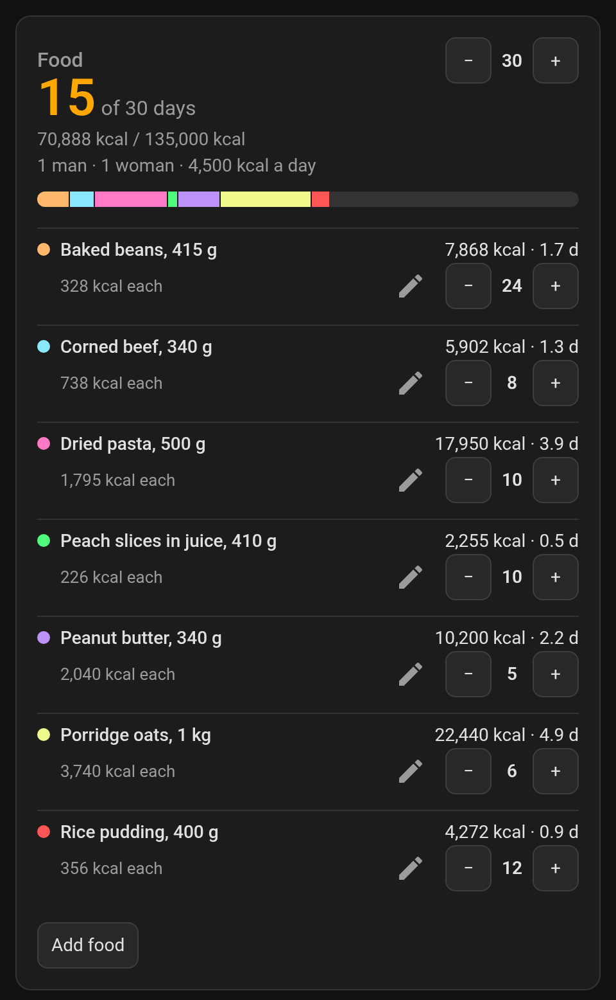

| Light theme | Water, target met |
| --- | --- |
| 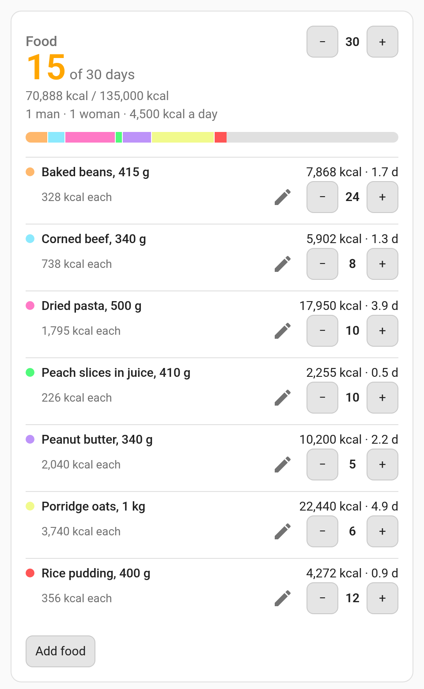 | 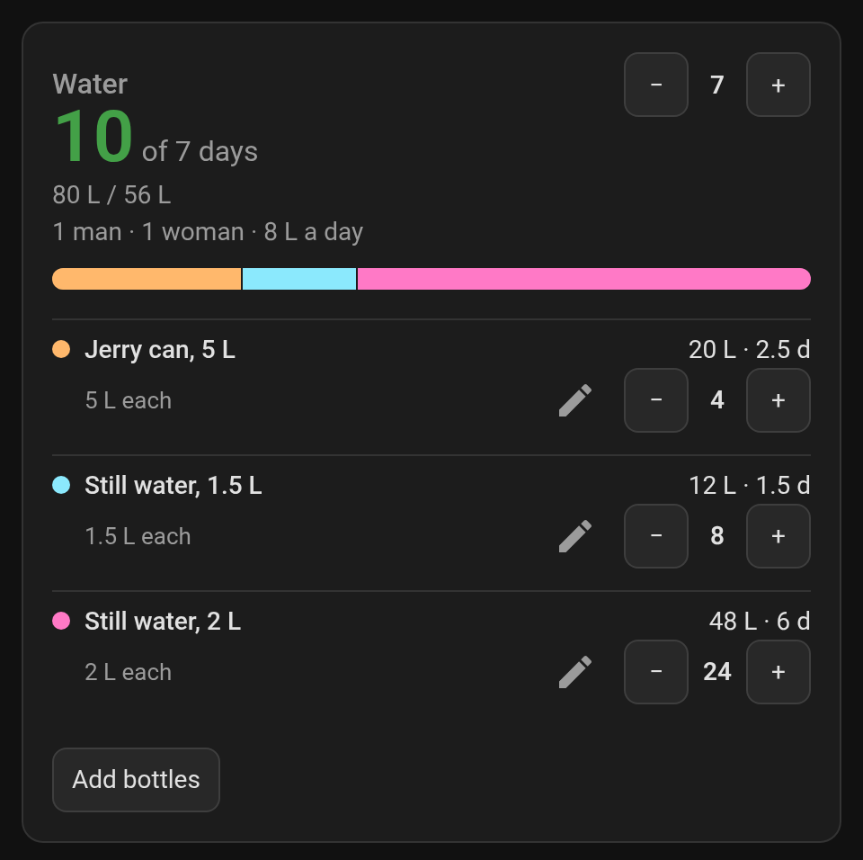 |

On a phone, long names wrap and the counters stay in reach:

<p>
  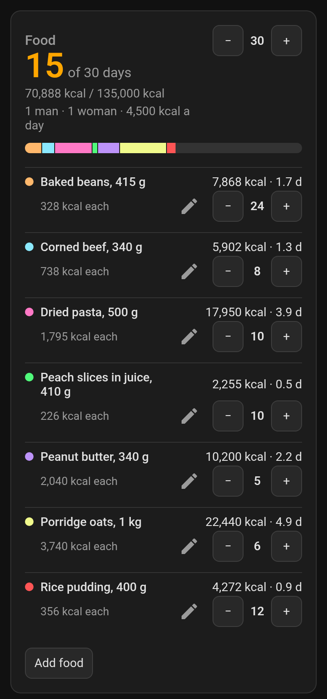
  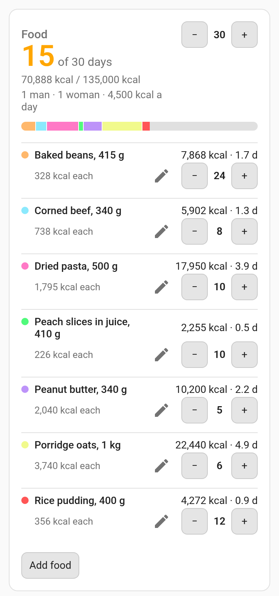
  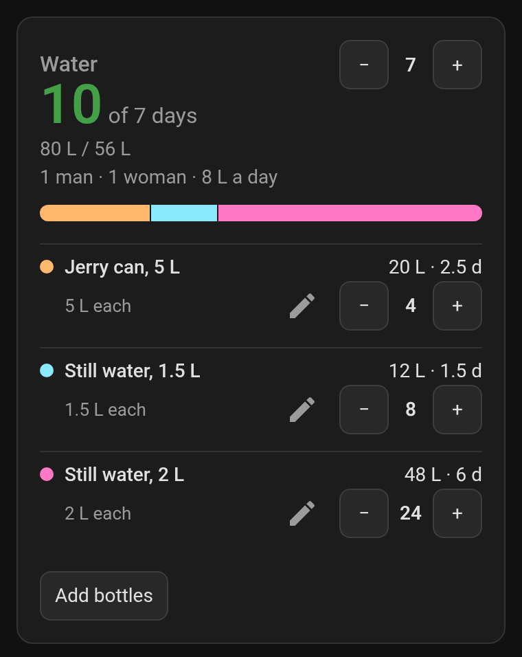
</p>

## Install

**HACS:** use the button, then download Prepping Cards.

[](https://my.home-assistant.io/redirect/hacs_repository/?owner=matteo-pacini&repository=HASSPrepping&category=plugin)

Or add this repository as a custom repository of type *Dashboard*.

**Manual:** copy `prepping-cards.js` to `config/www/`, then add `/local/prepping-cards.js` as a JavaScript module resource.

## Lists

Each card keeps its stock in a to-do list. By default:

| Card | List | Entity |
| --- | --- | --- |
| Food stockpile | Food stockpile | `todo.food_stockpile` |
| Water stockpile | Water stockpile | `todo.water_stockpile` |

If a card's list doesn't exist yet, the card offers to create it as a Local To-do list. Only an admin can; anyone else is told which list to ask for.

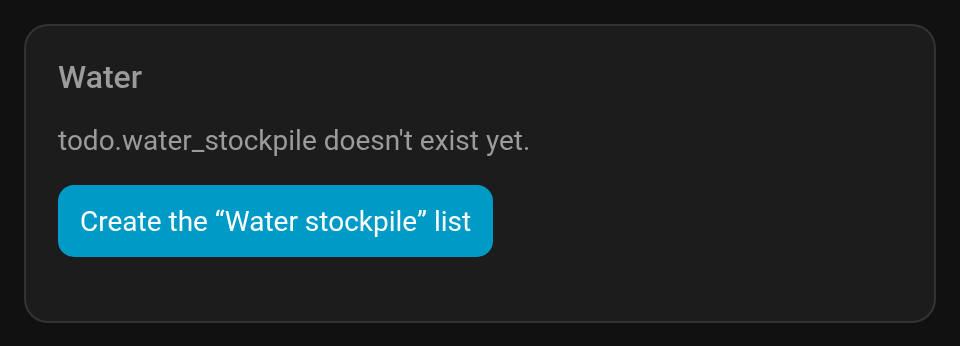

To create a list by hand: **Settings → Devices & services → Add integration → Local To-do**, named as in the table. The name sets the entity id, so *Food stockpile* becomes `todo.food_stockpile`. Any to-do list that can hold item descriptions works; point the card's `entity` at it.

## Usage

Add the cards from the dashboard editor and fill them in there, or write the YAML yourself. The visual editor has the list, the title, the number of men and women side by side, and the locale. Its labels are in English.

```yaml
type: custom:food-stockpile-card
entity: todo.food_stockpile
men: 1
women: 1
```

```yaml
type: custom:water-stockpile-card
entity: todo.water_stockpile
men: 1
women: 1
```

Everything else happens on the card:

- **− and +** beside the big number change the target number of days. It starts at 30 for food and 7 for water. The number turns green once the stock covers the target.
- **− and +** on a row count that item up or down.
- **Add food** or **Add bottles** opens a form. Food asks for the portion in grams and the calories per 100 g from the label; bottles ask for the litres each holds. The pencil on a row edits or removes it.

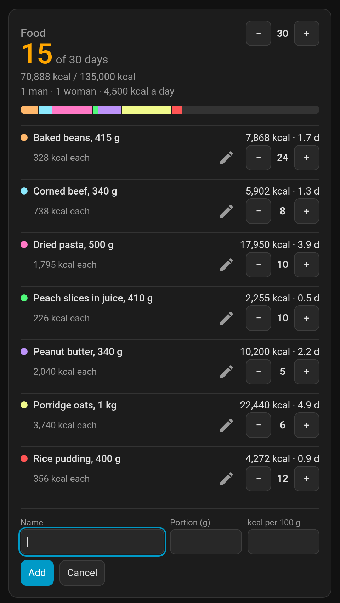

## Options

| Option | Default | Description |
| --- | --- | --- |
| `entity` | required | The to-do list that holds the stock |
| `title` | `Food` or `Water` | Card title |
| `men` | `1` | Adult men to feed, a whole number |
| `women` | `1` | Adult women to feed, a whole number |
| `locale` | Home Assistant's | BCP 47 tag, such as `de-DE`, for the card's text and numbers |
| `strings` | translated | Overrides for the card's own text, see below |

## Household

Set `men` and `women` to the adults in the household. The card adds up what they need a day, shows it under the totals (*1 man · 1 woman · 4,500 kcal a day*), and divides the stock by it to get days.

| Card | Per man | Per woman | Source |
| --- | --- | --- | --- |
| Food | 2,500 kcal | 2,000 kcal | NHS reference intakes for adults |
| Water | 4 L | 4 L | About a US gallon a day for drinking and basic hygiene, as FEMA advises |

For example, two men and one woman need 7,000 kcal and 12 L a day, so a 30-day food target is 210,000 kcal. Setting both to `0` makes the card ask for at least one person.

## Languages

<p>
  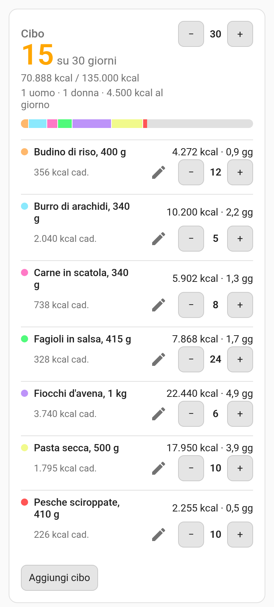
  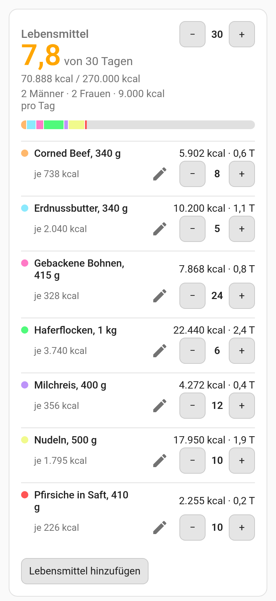
  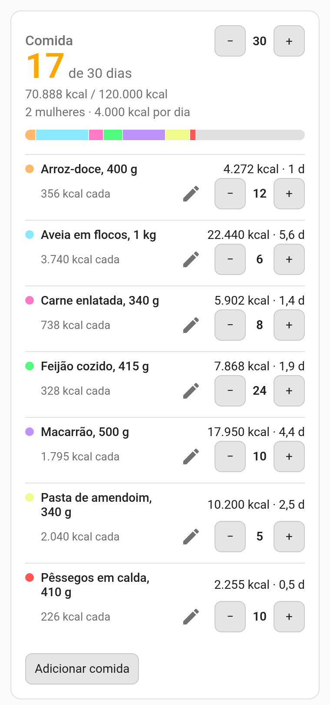
</p>

The cards' own text is available in English, Dutch, French, German, Italian, Polish, Portuguese, Brazilian Portuguese, Simplified Chinese, Spanish and Swedish. It needs no setup: the cards use `locale` if set, otherwise your Home Assistant language.

A regional locale uses its regional text if there is one, then its language, so `pt-BR` gets Brazilian Portuguese and `de-AT` gets German. Traditional Chinese is not translated yet, so it shows English rather than Simplified. Anything untranslated falls back to English. Numbers always follow the locale, whichever language the text is in. The names of your foods and bottles are shown as you typed them.

To change individual strings, use `strings`:

```yaml
strings:
  food: Pantry
  per_day: "{amount} every day"
  men:
    one: "{n} adult man"
    other: "{n} adult men"
```

Keys: `food`, `water`, `of_days`, `days_short`, `per_day`, `each`, `men`, `women`, `target`, `day_less`, `day_more`, `one_less`, `one_more`, `edit`, `add_food`, `add_bottles`, `name`, `portion`, `kcal_per_100g`, `litres_each`, `add`, `save`, `cancel`, `remove`, `empty_food`, `empty_water`, `loading`, `nobody`, `missing`, `create`, `ask_admin`, `save_error`, `create_error`. Keep the `{n}`, `{amount}`, `{name}`, `{entity}` and `{error}` placeholders. `of_days`, `men` and `women` change with the number: give one string for every number, or a form per [plural category](https://cldr.unicode.org/index/cldr-spec/plural-rules) (`one`, `few`, `many`, `other`, …) with `other` as the fallback.

## How the data is stored

Each food or bottle size is one to-do item. The item's name is what the card shows, and its description holds the figures as JSON:

```json
{"portion_g": 300, "kcal_per_100g": 439, "count": 4}
```

```json
{"litres": 2, "count": 16}
```

One more item per card, *Food stockpile settings* or *Water stockpile settings*, holds its target: `{"target_days": 30}`. Items whose description is none of these are left alone and not shown, so both cards can share one list.

Items can be renamed in the to-do list itself. Edit a description there only if it stays valid JSON; otherwise the card stops showing that item.

## License

MIT
